# SentinelMesh：可验证的智能研发交付控制平面

版本：`design-v1`  
状态：实施设计，尚未宣称生产实现  
覆盖：`code-kit-v2` 01–13（13 为可选 Observer）

## 1. 摘要

SentinelMesh 面向拥有多个 Git 仓库、多个操作系统和多个 AI/CLI 执行器的软件团队。它把漏洞、依赖升级、CI 失败、SLO 事故、API/文档漂移和人工修复请求，转换为可审核、可执行、可验证、可恢复的变更候选。

系统的交付物不是一句“已完成”，而是一组可以复核的证据：固定代码和环境基线、有效配置快照、PlanningBundle、双格式合同、审批和输入锁、插件内容锁、DAG 调度记录、原始 CLI 流、标准事件、独立检查结果、项目状态、迁移记录以及回退证据。

系统不自动合并代码、不直接发布生产环境、不让模型自我审批，也不把模型自述、退出码 0、日志上传成功或 Observer 摘要当作验收事实。

当前目录的材料存在三个边界：

1. `README.md` 列出了 `11-second-cli-adapter.md`，但当前目录没有该正文；实施前必须补齐并固定摘要。
2. `code-kit-v2-design.md` 与 `01-baseline/README.md` 是现有文档中的导航目标，但当前工作区没有这两个文件。
3. 各验证报告主要是 Linux 容器中的合成参考验证；真实 Pi、第二 CLI、原生 Windows/macOS、生产账本、迁移和断电恢复仍应记录为 `NOT_RUN` 或 `NOT_IMPLEMENTED`，不能直接升级为项目通过。

本设计依据：[实施索引](README.md)、01–10、12、13 文档以及当前目录中的验证报告。它是目标系统的完整设计，不代表现有仓库已经完成这些能力。

当前仓库同时提供一个标准库原型，代码位于工作区根目录的 `sentinelmesh/`，测试位于 `tests/`。原型已实现公共协议、严格 JSON、资源和事件证据、配置/profile、审批锁、插件锁、adapter 描述符、受控子进程、DAG/预算调度、项目状态投影、验收聚合、日志/指标/DebugBundle、Observer 降级和迁移 CAS 预览。真实供应商 CLI、原生 Windows Job Object、分布式数据库、生产凭据和真实迁移仍保持接口边界并记录为未运行能力。

## 2. 产品范围和成功标准

### 2.1 业务闭环

1. 摄取一个变更请求，记录仓库、目标、来源、影响范围、风险和预算。
2. 只读采集 Git HEAD、工作区、未跟踪文件、子模块、依赖锁和工具链，生成不可变基线。
3. Planner 生成事实、假设、未决问题、风险、任务图和预算方案。
4. 核心编译器把规划结果编译为 Markdown/JSON 双格式合同。
5. 审核服务锁定代码、配置、插件、环境、规则、检查集和权限。
6. Scheduler 根据 DAG、资源冲突、租约和预算派遣任务。
7. Pi 和第二真实 CLI 通过统一 adapter 在 Linux、macOS、Windows 原生 runner 上运行。
8. 独立插件执行代码、文档、测试和变异检查，生成带来源的验收观察。
9. Project Projector 从追加事件重建状态、决定索引、brief 和恢复入口。
10. Integration Controller 进行验收、迁移、切换、验证或回退。
11. Observer（默认关闭）只生成有来源的阅读辅助建议，不改变任何事实或权限。

### 2.2 成功标准

- 每个结论可追溯至固定代码、配置、合同、插件、环境和原始流。
- 影响行为的输入变化会使相关审核精确失效。
- 离线 stub、真实 CLI、真实 OS 三种证据严格分层。
- `PASS`、`FAIL`、`NOT_RUN`、`BLOCKED`、`NOT_APPLICABLE` 永远不互相替代。
- 重放、重试、恢复、响应丢失和控制器重启不会重复启动或重复计费。
- Observer 关闭后，规划、执行、审核、验收和恢复仍完整可用。
- 12 模块可以汇总 01–11 的证据，但不能以一次全量测试掩盖模块缺口。

### 2.3 非目标

- 不自动 commit、merge、deploy 或支付外部账单。
- 不根据模型文本授予权限、批准合同或修改项目状态。
- 不把 WSL 结果冒充 Windows 原生结果。
- 不通过关闭门禁、删除失败日志或重写历史来恢复执行。

## 3. 总体架构

```mermaid
flowchart LR
  U[Change Request / CLI / Web UI] --> API[Control Plane API]
  API --> BASE[Baseline Registry]
  API --> CFG[Config and Profile Resolver]
  CFG --> PLAN[Planner]
  PLAN --> CONTRACT[Contract Compiler]
  CONTRACT --> APPROVAL[Approval and Input Lock]
  APPROVAL --> PLUG[Plugin Catalog and Lock]
  PLUG --> SCHED[Workflow Scheduler]
  SCHED --> ADAPTER[CLI Adapter Gateway]
  ADAPTER --> L[Linux Runner]
  ADAPTER --> M[macOS Runner]
  ADAPTER --> W[Windows Runner]
  L --> EVID[Immutable Evidence Store]
  M --> EVID
  W --> EVID
  EVID --> VERIFY[Verification and Acceptance]
  EVID --> PROJ[Project Event Projector]
  PROJ --> STATE[State / Brief / Decision Views]
  STATE --> OBS[Optional Observer]
  SCHED --> LEDGER[Budget and Usage Ledger]
  VERIFY --> MIG[Integration and Migration Controller]
```



### 3.1 组件边界

| 组件 | 责任 | 不拥有的权限 |
|---|---|---|
| Control Plane API | 请求、查询、审核入口、恢复预览 | 不直接启动 CLI |
| Baseline Registry | Git、工作区、工具链和输入闭包 | 不修改用户工作区 |
| Config Resolver | runtime/profile/role、语义快照、环境计划 | 不读取未授权凭据 |
| Planner | 调查、任务图、风险、预算、未决问题 | 不审批、不派遣、不改代码 |
| Contract Compiler | PlanningBundle 到合同 IR、MD/JSON 发布 | 不签发批准 |
| Approval Service | 审核、锁、撤销、替代、CAS | 不替调度器扣费 |
| Plugin Catalog | manifest、依赖、能力、资源和 PluginLock | 不自授予权限 |
| Scheduler | DAG、领取、租约、预算、重试、停止 | 不自动集成 |
| Adapter Gateway | probe、调用构造、事件标准化、结果采集 | 不改变准入规则 |
| Native Runner | argv/shell、进程监督、超时、取消、清理 | 只管理受控进程范围 |
| Evidence Store | 原始流、标准事件、报告和不可变对象 | 不生成语义 PASS |
| Verification | 固定检查集、oracle、证据归约 | 不接受模型自述 |
| Project Projector | 状态、brief、决定、恢复视图 | 不提供执行授权 |
| Migration Controller | 预检、备份、切换、验证、回退 | 不覆盖用户后续修改 |
| Observer | 有来源的摘要建议 | 不写事实、审核、合同和决定 |

生产环境使用事务数据库保存索引、审核、调度和账本，使用不可变对象存储保存原始流和报告。SQLite 用于离线参考、单机开发和恢复演练。对象必须先写临时对象、同步、校验，再登记索引；对象和索引任一步失败都不能发布可用引用。

## 4. 公共身份、状态与记录

### 4.1 统一身份

```text
project_id, repository_id, request_id
plan_key, plan_revision
task_id, attempt_id, run_id, operation_id
event_id, seq, controller_generation
contract_id, contract_revision, approval_id
plugin_lock_id, environment_id
adapter_revision, role, profile, provider, model
```

`request_id` 是预算根；重连、换角色和重试不重置它。真实重试创建新 `run_id`；重放不创建新调用；恢复不等于重试。

### 4.2 正交状态轴

| 轴 | 状态示例 |
|---|---|
| 规划 | `DRAFT / READY / BLOCKED / PUBLISHED` |
| 审核 | `PENDING / APPROVED / REVOKED / SUPERSEDED / EXPIRED` |
| 执行 | `QUEUED / RUNNING / STOPPING / STOPPED / START_UNKNOWN / RECOVERY_REQUIRED` |
| 验收 | `PASS / FAIL / ERROR / NOT_RUN / BLOCKED` |
| 集成 | `NOT_SELECTED / STAGED / ACCEPTED / INTEGRATED / ROLLED_BACK` |

禁止用一个 `DONE` 或 `success=true` 字段覆盖所有状态轴。

### 4.3 运行事件 envelope

```json
{
  "schema_version": 1,
  "record_type": "run-event",
  "event_id": "evt-...",
  "project_id": "proj-...",
  "request_id": "req-...",
  "task_id": "task-...",
  "attempt_id": "att-...",
  "run_id": "run-...",
  "seq": 42,
  "observed_at": "2026-10-03T05:00:00Z",
  "role": "executor",
  "profile": "exec.default",
  "type": "process.exited",
  "source_kind": "core",
  "payload": {
    "exit_code": 0,
    "stop_reason": "completed",
    "protocol_complete": true,
    "cleanup": "verified"
  },
  "raw_refs": [],
  "integrity": "complete",
  "adapter_revision": "pi-v1",
  "causation_id": "evt-...",
  "error": null
}
```

规则：同一 `run_id + seq` 的同字节重放幂等；不同字节报告 `E_EVENT_REPLAY_CONFLICT`；序号缺口报告 `E_EVENT_GAP`；不按时间戳自动补序；vendor 事件不能授予权限。

### 4.4 资源和证据

```text
ResourceRef = { kind, id, sha256, optional path }
```

证据分为 `captured_raw`、`redacted_raw`、`normalized_event` 和 `synthetic_fixture`。原始流按不可变 segment 保存，事件引用封存版本的半开字节区间 `[start,end)`。不得在普通日志中保存凭据、完整环境变量、完整提示词或秘密。

## 5. 业务接口和数据流

### 5.1 外部 API

```text
POST /v1/projects/{project_id}/change-requests
GET  /v1/projects/{project_id}/baselines/{baseline_id}
POST /v1/requests/{request_id}/planning
POST /v1/requests/{request_id}/contracts/drafts
POST /v1/contracts/{contract_id}/approvals
POST /v1/contracts/{contract_id}/publish
POST /v1/requests/{request_id}/runs
POST /v1/runs/{run_id}/cancel
GET  /v1/projects/{project_id}/status
GET  /v1/projects/{project_id}/brief
GET  /v1/runs/{run_id}/evidence
POST /v1/projects/{project_id}/migration/preview
POST /v1/projects/{project_id}/recovery/plan
```

所有写接口都要求 `operation_id`、当前 `controller_generation`、输入引用和预算上下文。重复 operation 同内容返回原结果；同 operation 不同内容报告冲突。

### 5.2 配置与角色

配置层级为：

```text
project → explicit profile → role → platform → approved local override
```

local override 只允许登记的入口定位和工具 locator，不能改变模型、权限、固定参数、预算和信任边界。策略按交集收紧；空 allow 集合表示禁止，不表示无限制。

解析顺序：严格解码 → 重复键检查 → schema → 字段语义 → 依赖闭包 → 有效配置 → 语义快照 → 环境计划。环境计划、环境实测、审核输入和启动状态必须分开记录。

### 5.3 规划与合同

`PlanningBundle` 至少包含：事实、假设、未决问题、需求映射、任务图、风险、预算、来源引用和计划版本。

合同发布过程：

```text
PlanningBundle
→ Draft Contract
→ Strict Schema Validation
→ Semantic Validation
→ Complete Input Closure
→ Approval Record
→ CAS Publication
→ Publication Receipt
```

Markdown/JSON 必须由同一 Contract IR 生成，且绑定同一 `contract_revision`、输入闭包和资源摘要。半发布状态不可执行。

### 5.4 插件和工作流

首批插件：

```text
repo-analysis
code-change
docs-change
python-checks
docs-checks
regression-tests
mutation-review
```

三个组合工作流：

```text
bugfix:        analyze → change → freeze → checks → review
documentation: analyze → docs-change → freeze → docs-checks → review
regression:    analyze → tests → mutation-review → review
```

插件只能声明输入、输出、权限需求和检查结果，不能签发审批、PASS、合同发布或权限提升。Manifest 必须使用受信 catalog；禁止动态 loader、任意 import、安装脚本、网络获取和自动发现。

### 5.5 调度和预算

调度器执行：DAG 类型检查、环检测、就绪、领取、资源锁、租约、心跳、handoff 再核验、预算预留、启动、结算、停止和恢复。

预算账本按 request 聚合：

```text
exposure = settled_known + reserved + unknown_liability
```

累计 usage、增量 usage、final usage、correction 和镜像事件必须分开处理；币种不能直接混加；unknown 不能补零。

## 6. 验证、测试和验收设计

### 6.1 证据结果格式

```json
{
  "case_id": "05-T17",
  "requirement_refs": ["05-A04", "12-A04"],
  "target_ref": "target-...",
  "environment_fingerprint": "env-...",
  "fixture_source": "synthetic|captured|native_observed|documented",
  "argv_redacted": [],
  "oracle": "...",
  "observation": "...",
  "artifact_refs": [],
  "cleanup": "complete|partial|unknown",
  "status": "PASS|FAIL|NOT_RUN|BLOCKED|NOT_APPLICABLE",
  "failure_code": null,
  "reviewer": "..."
}
```

### 6.2 测试层级

```text
冻结基线
→ 严格 JSON/Schema
→ 语义守卫
→ 黄金字节/哈希
→ 组件契约
→ 跨模块集成
→ 原生 OS
→ 真实 CLI
→ 故障注入
→ 恢复与迁移
→ 稳定性/容量
→ 证据审阅
```

离线参考、真实 CLI 和真实 OS 必须独立出报告。`SKIPPED`、`ERROR`、`CANCELLED`、`WAIVED`、`STALE`、缺 artifact、CI job 缺失、只测同一 CLI 两个 profile，都不能计作 PASS。

### 6.3 24 个跨模块主用例

每个主用例派生 happy path、单一故障、竞态和恢复四个变体，共至少 96 个最小测试；每项绑定一个或多个 01–13 验收编号。

逐条执行目录见 [sentinelmesh-test-catalog.md](sentinelmesh-test-catalog.md)。

| ID | 场景 | 通过判据 |
|---|---|---|
| V01 | 固定 HEAD、脏工作区、工具链指纹 | 基线不可变，前后漂移可见 |
| V02 | duplicate-key、未知 schema、非法 UTF-8 | 稳定 `E_SCHEMA_*`，无副作用 |
| V03 | ResourceRef 字节变化 | hash mismatch，相关审核失效 |
| V04 | seq 缺口、重复、同序列异字节 | gap/replay-conflict，不能静默修复 |
| V05 | delta/cumulative/final/unknown usage | 不重复累计，不把 unknown 当零 |
| V06 | 配置分层和越界 local override | 越权覆盖被拒绝 |
| V07 | 未注册 adapter、模型或 placeholder | 不联网、不启动、不自动替换 |
| V08 | v1/v2 双读迁移 | 历史字节和 hash 保持不变 |
| V09 | 审核后输入漂移 | prepare/run 两入口都阻断 |
| V10 | same-head 双提交 | CAS 只有一个成功 |
| V11 | 文件/DB/响应丢失和进程崩溃 | 恢复幂等，不重复登记或启动 |
| V12 | adapter 能力协商和 vendor 原始流 | 事件可回指原始字节 |
| V13 | stdout/stderr 截断、写失败、脱敏失败 | integrity incomplete，不能 PASS |
| V14 | Linux/macOS/Windows argv、Unicode、CRLF | 差异有原生证据，WSL 单列 |
| V15 | timeout/cancel/TERM-KILL 竞态 | 首个 stop reason 粘性，清理结果真实 |
| V16 | Job/进程组/setsid/PID reuse | 不误杀、不误报清理 |
| V17 | manifest 循环、权限超集、成员删改 | PluginLock 拒绝 |
| V18 | DAG 环、重复 task、lease 竞态 | 仅一次有效领取 |
| V19 | retry、budget、unknown、START_UNKNOWN | 不自动免费重跑，不超预算 |
| V20 | 三类插件 setup/check/apply/verify | 阶段顺序和部分失败可恢复 |
| V21 | PlanningBundle 事实不足 | 输出 `investigation_needed`，不暗执行 |
| V22 | 草稿 revision/head CAS 和发布 | 双格式同源，复用审核和预算 |
| V23 | 投影、outbox、cursor、generation、brief | 幂等、RESET 明示、来源完整 |
| V24 | 第二 CLI、三平台、CI、迁移、Observer 关闭 | 全链路逐格证明，缺证据保持 NOT_RUN |

### 6.4 模块测试目录

- **01：** 固定序列化、路径边界、版本族、ResourceRef、事件 gap/replay、脱敏、unknown usage、G0–G6 回归。
- **02：** 配置层级、profile 绑定、未注册 adapter、语义快照、local 白名单、凭据不回显、v1/v2 迁移。
- **03：** ApprovalRecord、输入闭包、CAS、撤销、替代、精确失效、并发提交、响应丢失、START_UNKNOWN。
- **04：** probe 能力、argv、输入通道互斥、Pi 旧入口、工具生命周期、身份变化、原始流和标准事件。
- **05：** 三平台启动、shell/argv、EOF、超时、取消、进程组、Windows Job、PID 重用、TOCTOU、清理。
- **06：** manifest、依赖图、路径、资源 hash、权限交集、模板注入、锁发布、GC 和并发 pin。
- **07：** DAG、就绪、领取、租约、幂等、预算、usage 修订、停止、恢复、旧 owner 隔离。
- **08：** 七插件、三组合、固定候选、独立检查、文档链接、变异 oracle、反测有效性和清理。
- **09：** 两级规划、事实来源、草稿、Contract IR、MD/JSON、发布 CAS、规划权限和预算。
- **10：** 事件投影、SourceKey 冲突、outbox、generation、brief 限制、决定 CAS、回退和重建。
- **11：** Pi 与第二 CLI 的真实异构能力矩阵及完整 Planning→Contract→Run→Evidence 链路。
- **12：** 01–11 交接、107 条要求映射、三平台、CI 缺 job、artifact mismatch、迁移/回退。
- **13：** 关闭降级、来源引用、去重、预算、超时、游标、pull-only、不可写事实。

### 6.5 CI 聚合规则

- 必需 job 不允许 `continue-on-error`。
- 缺 job、被取消、无 artifact、artifact manifest 不匹配都 fail-closed。
- CI 聚合器保留每个目标的缺口行，不压缩成一个绿色汇总。
- `evidence_readiness=COMPLETE` 只表示证据结构完整，不等于业务集成 PASS。

### 6.6 现有材料的证据边界与验收登记

当前验证报告中的数字只代表文档内参考实现或合成夹具：03 报告为 72 项，04 为 95 项，05 为 83 项，06 为 100 项，07 为 82 项，08 为 99 项，09 为 90 项，10 为 76 项；12 报告为 80 项。12 报告同时记录 `evidence_readiness=PARTIAL`、必需项 3 项中仅 1 项通过、`can_dispatch=false`，107 条原始要求的 `target_project_status=NOT_RUN`。这些数字不得写入生产健康度或项目完成度。

验收登记必须保留文档中的原编号：01-A01–A16、02-A01–A20、03-A01–A24、04-A01–A26、05-A01–A30、06-A01–A25、07-A01–A30、08-A01–A28、09-A01–A28、10-A01–A30、12-A01–A29、13-A01–A09；11 的编号和正文待材料补齐后登记。12 的 IT01–IT36 必须作为独立真实集成/故障 case 展开，不能由 V01–V24 的离线测试替代。

每个登记项必须包含 `requirement_id`、`case_id`、固定 `target_ref`、环境、fixture 来源、oracle、证据成员、审阅者和状态。缺机器、真实 CLI、授权、预算、凭据、平台或恢复能力时，状态保持 `NOT_RUN` 或 `BLOCKED`，不得改成 `N/A` 或缩小分母。

## 7. 日志、监测和告警

### 7.1 日志流

#### 事实事件日志

追加写 JSONL/对象，包含 event envelope、错误码、因果关系、时限、证据引用和脱敏配置。门禁、审计和恢复事件永不采样。

#### 审计日志

记录审批、撤销、替代、权限 epoch、配置变更、预算、迁移、回退和敏感证据读取，包含 actor、reason、before/after refs 和结果。历史不可删除。

#### 诊断日志

级别为 `DEBUG/INFO/WARN/ERROR/FATAL`，错误码分为：

```text
E_SCHEMA_* E_PATH_* E_RESOURCE_* E_BASELINE_* E_APPROVAL_*
E_EVENT_* E_USAGE_* E_JOB_* E_SCHEDULER_* E_CLEANUP_*
E_MIGRATION_* E_OBSERVER_*
```

每条错误都含 `phase`、`retryable`、`source_ref`、`reason`、`hint`。`retryable=true` 不自动授权重试。

### 7.2 监控指标

```text
gate_reject_total{code,phase}
approval_drift_total
cas_conflict_total
lock_contention_total
queue_wait_seconds
run_duration_seconds
timeout_total / cancel_total
start_unknown_total
orphan_process_total / cleanup_unknown_total
event_seq_gap_total / event_replay_conflict_total
incomplete_raw_total / manifest_hash_mismatch_total
artifact_missing_total
projection_lag_seconds / outbox_backlog_age_seconds
budget_reserved / budget_settled / budget_remaining
usage_unknown_total / budget_exposure_over_limit
migration_stage / rollback_total
observer_dedupe_hit_total / observer_degrade_total
brief_staleness_seconds
```

Trace 从 `request → plan → task → run → adapter → process → event → projection` 贯穿。Trace 属性只使用低基数身份和状态；正文、提示词、凭据和原始环境只能通过受控证据引用访问。

### 7.3 告警

- **P0：** seq/hash 冲突、凭据泄漏、未受控进程、审计写失败、预算越界、必需 CI job 缺失。
- **P1：** projection lag、outbox backlog、START_UNKNOWN、cleanup unknown、重复 operation、artifact mismatch。
- **P2：** Observer 降级、brief 过期、费用未知、非关键重试增加。

告警必须包含项目、request/run/case、controller generation、证据引用、当前状态和只读排查命令。告警投递与已读分别记录。

## 8. 调试、重放和恢复

### 8.1 DebugBundle

每次 ERROR、START_UNKNOWN、恢复需求或迁移失败生成只读 DebugBundle，包含：

```text
bundle_version / incident_id / source_case_ids
baseline/worktree/head/untracked
OS/arch/tool versions
config/profile/adapter refs and hashes
plan/contract/approval/plugin lock refs
run/attempt/controller generation
redacted argv/cwd/shell
event cursor and seq range
stdout/stderr raw and redacted refs
PID/creation time/boot/Job/pgid
exit_code/stop_reason/protocol/usage/cleanup
budget ledger/manifest/index hashes
projection/brief snapshot
failure code/reproduction recipe/retention policy
```

DebugBundle 只读、加密、受 ACL 保护，有独立摘要；不能替代审核、验收或自动重跑。

### 8.2 只读诊断入口

```text
smctl debug timeline --run RUN_ID
smctl debug gate-explain --operation OP_ID
smctl debug projection-diff --project PROJECT_ID
smctl debug resource-graph --contract CONTRACT_ID
smctl debug process-tree --run RUN_ID
smctl debug usage-ledger --request REQUEST_ID
smctl debug migration-diff --operation OP_ID
smctl debug bundle --run RUN_ID
```

诊断输出必须携带对象 ID、scope、generation、输入 hash、证据 refs、时间和 unknown/NOT_RUN/BLOCKED 原因。

### 8.3 确定性重放

重放只使用冻结的 ResourceRef、fixture、代码版本、Schema、adapter revision、配置和规则。默认无网络、无凭据、无用户仓库写权限；生成新的 `replay_id`，标明 synthetic，不覆盖历史。真实 CLI 重放必须新建 run、重新审核并重新计费。

### 8.4 故障注入

必须覆盖：JSON 解码、fsync、数据库提交、outbox、CAS、adapter 断流、stdout/stderr 写失败、脱敏失败、timeout/cancel、supervisor 强杀、Job/进程组绑定、PID reuse、WAL 恢复、artifact 上传、manifest mismatch、CI 缺 job、Observer source conflict、断电和响应丢失。每个注入点都有 watchdog、残留扫描和清理证据。

### 8.5 恢复状态机

```text
RUNNING → STOPPING → STOPPED / START_UNKNOWN / RECOVERY_REQUIRED
```

迁移状态：

```text
DISCOVERED → PREFLIGHTED → BACKUP_VERIFIED → PLAN_REVIEWED
→ DRAINING → STAGED → SWITCHED → VERIFYING → ACCEPTED
                                      ↘ HOLD / FAILED → ROLLING_BACK
```

任何 unknown 都进入调查，不以重试覆盖。旧 controller generation 不能继续修改当前调度。

## 9. 迁移和交付门禁

### 9.1 迁移步骤

1. 只读盘点用户工作、活动进程、预算、授权、规则、技能和备份。
2. 固定 IntegrationTarget、候选、输入闭包和 CheckCatalog。
3. 生成逐字段 before/after 预览和补偿计划。
4. 备份工作区、索引、历史、账本和必要对象，并做隔离恢复读验。
5. 冻结新派遣、排空活动运行并处理迟到事件。
6. 使用 CAS 和代际条件执行暂存和切换。
7. 验证旧合同、旧入口、三平台、第二 CLI、插件和状态恢复。
8. 验证通过才登记 `ACCEPTED`；任何未知保持 `HOLD`。
9. 失败时只回退明确记录的目标，不覆盖用户后续修改。

### 9.2 发布交付物

```text
evidence-index.json
support-matrix.json
failure-register.json
migration-rehearsal.json
project-status.json
project-brief.md
recovery-runbook.md
```

### 9.3 最终发布门槛

- 01–11 必需验收均绑定固定 target、环境、oracle、artifact 和审阅者。
- 三个平台真实结果齐备；WSL、容器和模拟结果单列。
- 至少一条 Pi + 第二 CLI 的真实异构完整链路通过。
- v1 历史字节、旧入口、旧 attempt/verdict 读取不变。
- 三个首批插件组合工作流通过独立检查。
- 迁移、备份恢复和回退演练通过。
- Observer 关闭时核心规划、执行、审核、验收和恢复通过。
- 所有 unknown、NOT_RUN、BLOCKED、限制和未实现项仍显式保留。

## 10. 分阶段实施顺序

### Phase 0：材料和基线

补齐 11 正文、恢复缺失导航文档、固定 01–13 摘要、取证旧入口、G0–G6、退出码和 attempt 规则。

### Phase 1：公共核心

实现 01 协议、ResourceRef、严格 JSON、哈希、事件、错误码，再接入 02 配置和 03 审核/锁。完成离线黄金向量和单故障拒绝测试。

### Phase 2：执行运行时

实现 04 Pi adapter、05 原生 runner，并尽早接入 11 第二 CLI，完成能力矩阵、原始流、进程监督、usage 和清理。

### Phase 3：插件与调度

实现 06 manifest/lock、07 DAG/租约/预算/恢复和 08 七个插件及三种组合工作流。

### Phase 4：规划与状态

实现 09 PlanningBundle、合同发布、10 事件投影、brief、决定索引和恢复。13 保持关闭，先确保确定性路径完整。

### Phase 5：集成迁移

执行 12 的证据汇总、三平台矩阵、异构 CLI 链路、迁移、备份、切换、回退和最终交付审阅。

## 11. 假设和待决事项

- 第二 CLI 首个生产目标暂定为 Claude Code CLI；最终以真实能力矩阵和授权为准。
- 生产支持 Linux、macOS、Windows 原生 runner，WSL 独立统计。
- Observer 默认关闭。
- 存储后端、告警通道、保留期和 SLO 数值是拟议实现参数，必须进入正式合同和配置版本。
- 真实项目验收之前，任何合成参考测试都不能替代原生平台、真实 CLI、授权、预算、账单和迁移证据。
